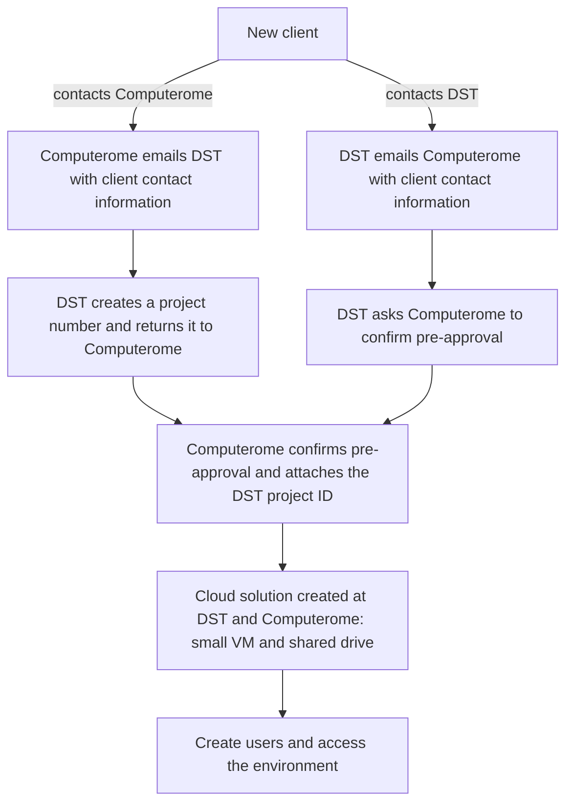

# Cloud Servers with Data Providers

Computerome provides the possibility to have a cloud project with a Data Provider.
For the time being the only available data provider we offer is Statistics Denmark.

Computerome offers our services with hosting a scalable Cloud environment with multiple Virtual Machines. Like with our normal Cloud solution you can as client scale up and down to match your needs.

The main difference between a regular Computerome Cloud project and this new variant is that you will use Statistics Denmark as your data provider as well as jumphost to access your Virtual Machines.

Computerome and Statistics Denmark have several integrated workflows using a messaging service which provides your project with functionality like:

- Handling users
- Importing data from Statistics Denmark to your Cloud project at Computerome
- Remote Desktop access through Statistics Denmark and SSH link to your Virtual Machines in Computerome
- Exporting data to your R/Python environment in Statistics Denmark
- Exporting smaller files for download in Statistics Denmark's Data Window (DDV)

Computerome Cloud with data provider has the same capabilities as a regular Cloud project concerning choices of operating systems, network and software modules.

!!! warning "No internet access, no web import/export"

    Since the data in a data provider project is governed by the data provider, the machines do not have internet access and you are not allowed to use Computerome's web interface for importing and exporting files. Import and export is handled through the data provider and is subject to the data provider's rules.

## Getting started

You will need to have a project created and contracts signed with both Statistics Denmark and Computerome.

Instructions for how to apply for a project at Statistics Denmark can be read on their page:
[https://www.dst.dk/en/TilSalg/data-til-forskning](https://www.dst.dk/en/TilSalg/data-til-forskning)

If you already have an existing project at Statistics Denmark you can ask them to add Computerome as HCP provider to the existing project.

### Both new and existing projects

To apply for a cloud project with data provider at Computerome please send us an email and we will get back to you as soon as possible.

### Workflow for project creation both new and existing projects

The workflow for these project applications is currently as follows:

1. **Initial contact:** the new client contacts either DST or Computerome.
    - If the client contacts Computerome, we send DST an email with the client contact information and ask them to create a project number and return this to us.
    - If the client contacts DST, they will send us an email with the client contact information and ask us to confirm pre-approval.
2. Computerome confirms pre-approval and attaches the DST provided project ID to the new project.
3. The Cloud solution will be created at both DST and Computerome. Computerome will automatically create a small Virtual Machine as well as a shared drive.
4. Once the project has been created and provisioned you are ready to create users and access the environment.



## How to manage users

Users are handled through Statistics Denmark's Data Window (DDV) and you need to log in using your account for [https://remote.dst.dk/](https://remote.dst.dk/).
From there, access your project using the DDV link on your dashboard.

When creating users you should follow the guides from Statistics Denmark.
Remember to attach the users to Computerome as HPC provider.

You can perform the following user actions in DDV:

- Create HPC users
- Reset password for HPC users
- Disable HPC users
- Enable HPC users
- Delete HPC users

## Accessing the remote desktop

1. Go to [https://remote.dst.dk/](https://remote.dst.dk/).
2. Sign in and then select one of the "FSE Windows" shortcuts.
3. When signed in to the DST remote desktop you will now see a shortcut on your desktop: "HPC adgang!".
4. This will open a MobaXterm from where you can SSH to any virtual machine in your Computerome cloud solution, using the syntax:

    ```bash
    ssh ip@username
    ```

You can use the Computerome Module loader to load an X11-based (X Window System) graphical user interface for your favorite application like "Visual Studio Code", "R-Studio" etc.
Please refer to the [main wiki page](software/cloud-software.md#cloud-environment-modules) for instructions.

## Using Data

With a data provider project you will have access to all the data provided by the provider directly on your Computerome Cloud Virtual Machines.

### Import

When you import data through e.g. DDV, the data will be staged at the data provider and a message will be sent to Computerome automatically that the data delivery is ready.
Computerome then automatically downloads the files in the import and places them in your shared drive in your Cloud network share.
Computerome then automatically informs the data provider when the download is complete and the imported data is available in the Cloud share.

```bash
cd projectshorthandname/shared/dst/import/UUID-of-the-import
```

You should be able to see the import status and the UUID of the delivery at your data provider's interface.

### Export

To export data from your cloud environment at Computerome we have created a few helper scripts:

- `create_export.sh`
- `view_messages.sh`

These scripts are located at:

```bash
cd projectshorthandname/shared/dst/scripts
```

To view input variables you can run the scripts with the `-h` option, e.g.:

```bash
./create_export.sh -h
```

Once you have exported a file it will be sent to the data provider.

### Statistics Denmark specific

Statistics Denmark will place the file in your project workfolder on your workdrive, which you can view using the R/Python remote desktop.

Files up to 2GB are allowed, but if you also want to export the file for download in DDV there is a different limit which can be found in Statistics Denmark's guidelines.

## Further Information

We hope with this guide you will be able to get started to work with data from your favorite data providers in Computerome's Cloud environment.
Since the Cloud Server with data provider is the same on almost all functionality aspects of regular Computerome Cloud solutions, we ask you to please refer to our [general wiki](index.md) as well.
