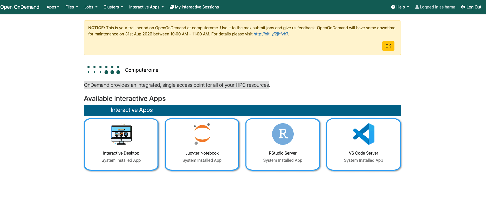
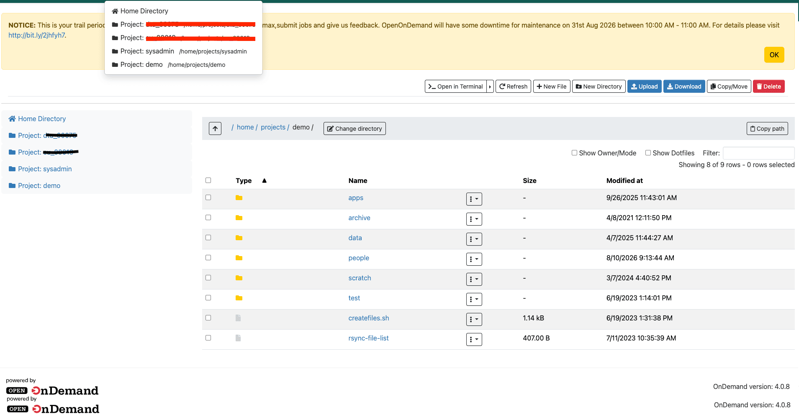
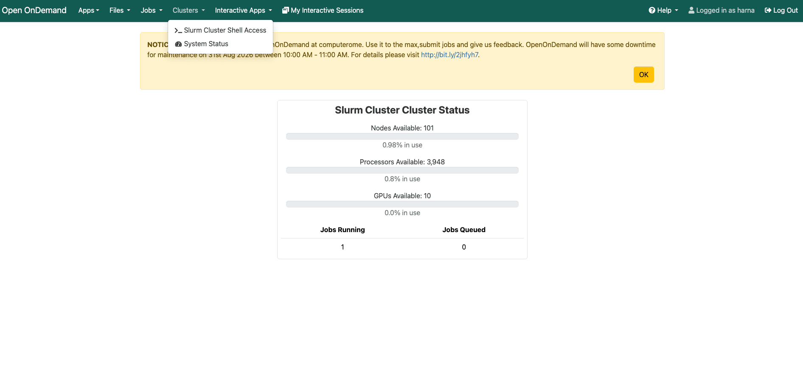

# Open On Demand

OnDemand provides an integrated, single access point for all of your HPC resources.

[:lucide-external-link: Computerome OpenOnDemand Portal](https://ood.computerome.dk/){ .md-button .md-button--primary }

## Log in

Connect to [https://ood.computerome.dk/](https://ood.computerome.dk/) and log in with your HPC account and password.

!!! warning "10 second limit for the push token"

    There is currently a 10 sec time limit to accept the push notification on your phone.
    Please have the push token present and ready to accept in
    [privacyIDEA](../two-factor-authentication-2fa.md) while you log in.

## Interactive applications

This should open the portal to our HPC resources, where you can run multiple applications interactively, such as RStudio Server, VS Code, interactive desktops etc.

{ loading=lazy }

## File manager

You can also use the file manager to upload and download data from your projects directly with this portal.

{ loading=lazy }

## Jobs

You can start your interactive desktop sessions and also submit your jobs via **Job Composer** or through **Slurm Cluster Shell Access** under the **Clusters** tab.

{ loading=lazy }

You can track the status of the jobs under the **Jobs** tab on the navigation bar.
