# Two Factor Authentication (2FA)

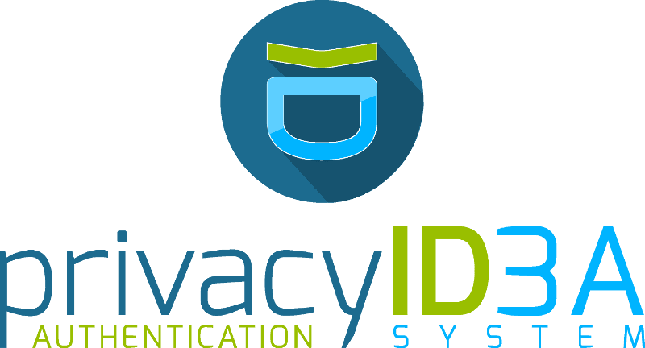{ width="80" align=right }

Computerome requires two factor authentication for every HPC and Cloud login.
No other software token than the **privacyIDEA** app is supported. This guide
covers installing the app and using the privacyIDEA web interface to register
and manage your tokens.

- :lucide-smartphone: **[Step 1: Install the app](#step-1-install-the-app)**
- :lucide-log-in: **[Step 2: Log in to the web interface](#step-2-log-in-to-the-web-interface)**
- :lucide-key-round: **[Step 3: Enroll a token](#step-3-enroll-a-token)**

## Step 1: Install the app

Install the official privacyIDEA authenticator app on your mobile phone.

=== ":fontawesome-brands-apple: iOS"

    [Download privacyIDEA for iOS](https://apps.apple.com/us/app/privacyidea-authenticator/id1445401301){ .md-button .md-button--primary }

    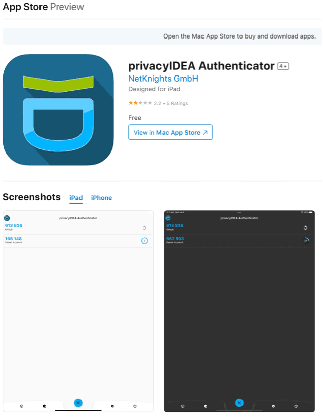{ loading=lazy }

=== ":fontawesome-brands-android: Android"

    [Download privacyIDEA for Android](https://play.google.com/store/apps/details?id=it.netknights.piauthenticator){ .md-button .md-button--primary }

    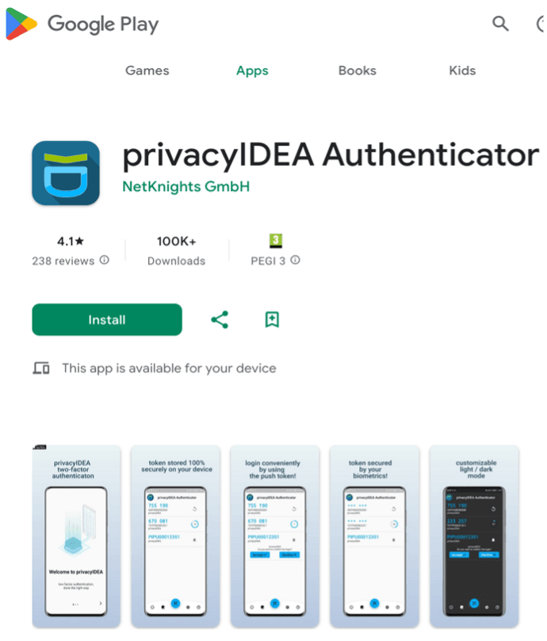{ loading=lazy }

## Step 2: Log in to the web interface

Open [https://pi.computerome.dk](https://pi.computerome.dk/) in your browser and
log in with your Computerome username and password.

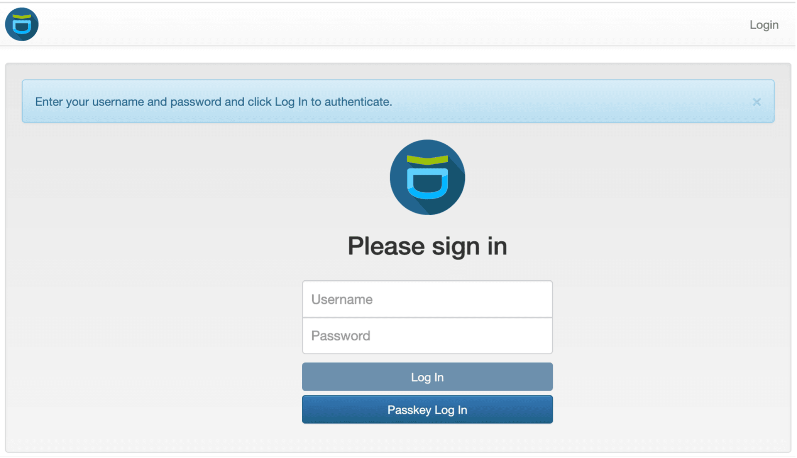{ loading=lazy }

## Step 3: Enroll a token

After logging in, open the **Tokens** section and click **Enroll Token** in the
left sidebar.

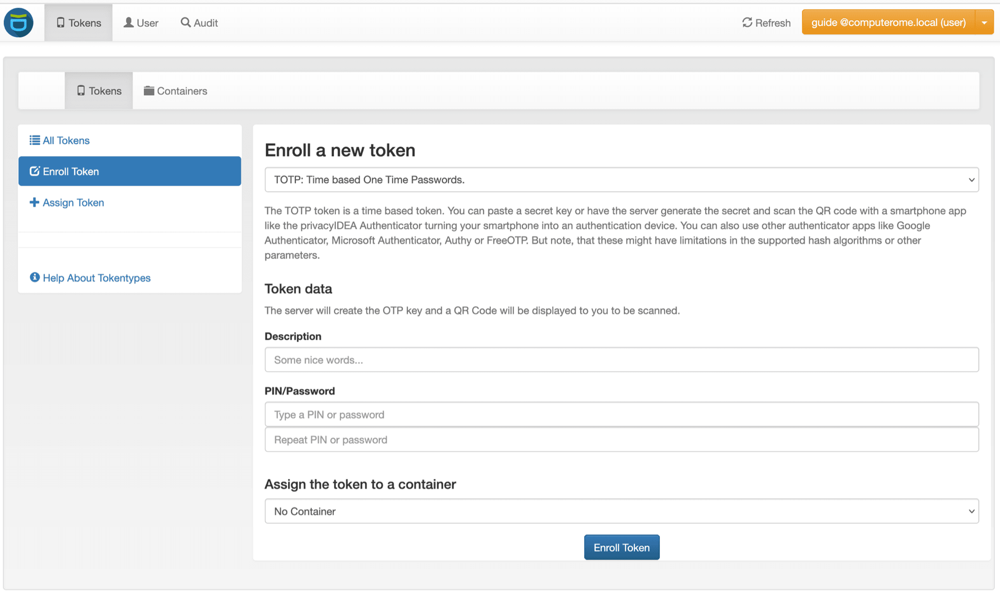{ loading=lazy }

The **Enroll a new token** list offers four token types: HOTP, TOTP, PUSH and SMS.

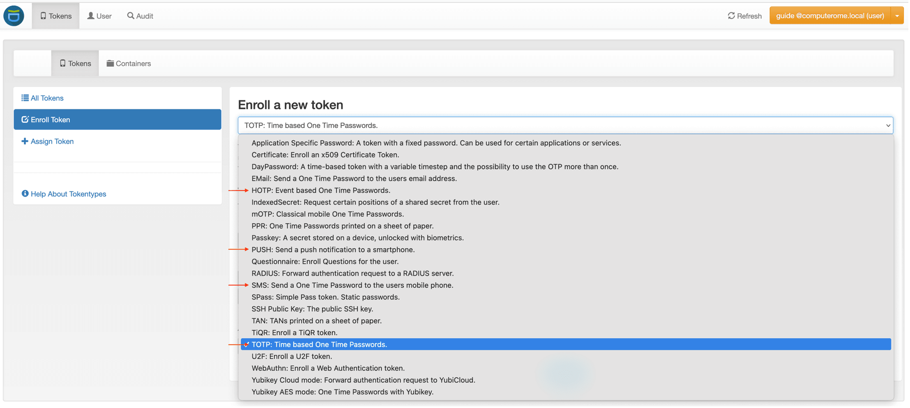{ loading=lazy }

!!! tip "Recommended setup: two tokens"

    Create a **PUSH** token as your primary token and a **HOTP** or **TOTP**
    token as a backup.

    When a PUSH token exists alongside HOTP or TOTP tokens, the PUSH token takes
    priority: you must approve the push request on your phone to complete
    authentication.

=== "HOTP"

    **Event-based one-time password.** The app generates a new code each time
    you tap the token's refresh button.

    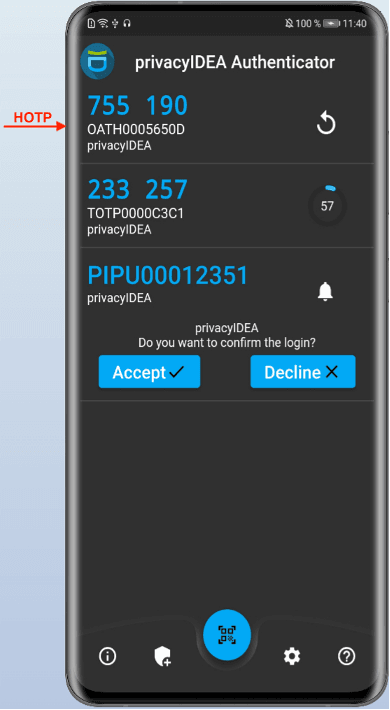{ loading=lazy }

    1. Select **HOTP** from the list of token types.

        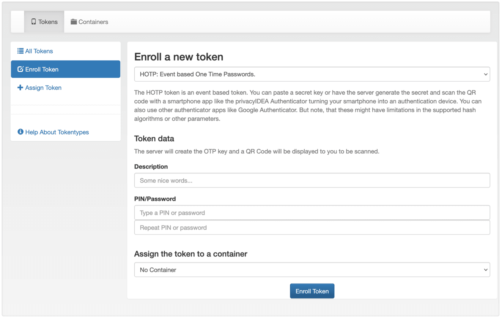{ loading=lazy }

    2. Optionally, enter a description.
    3. Leave the **PIN/Password** field empty.
    4. Leave **Assign the token to a container** set to **No Container**.
    5. Click **Enroll Token**. A QR code is generated and displayed.

        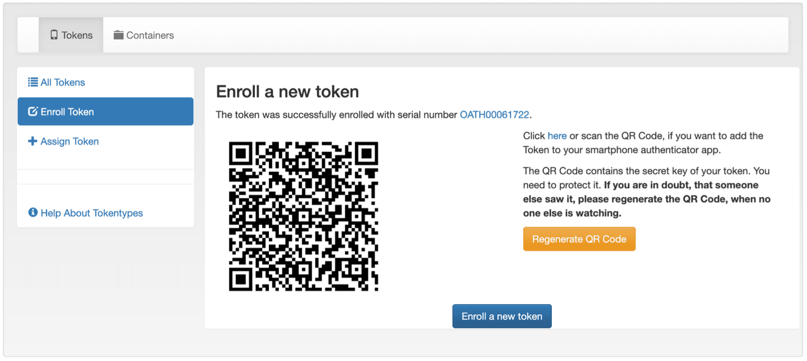{ loading=lazy }

    6. Open the privacyIDEA authenticator app on your phone.
    7. Tap the QR code icon and scan the QR code shown on the website. The token
       is added to the app.
    8. On the website, click **Enroll a new token** to confirm the enrollment.
    9. Click **All Tokens** in the left sidebar to view your token.

        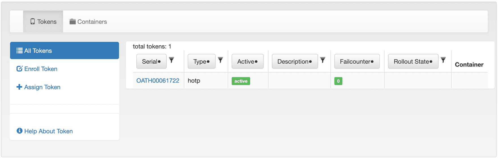{ loading=lazy }

    10. Click the token's serial number (for example `OATH00061722`) to view
        its details and manage settings.

        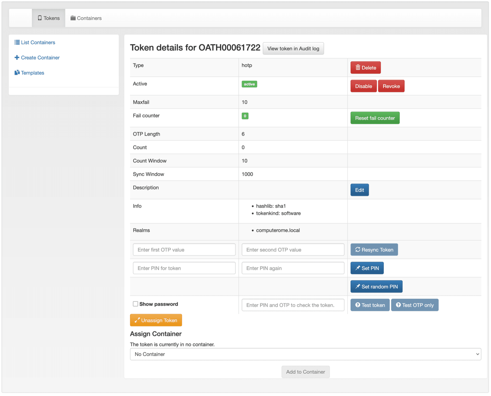{ loading=lazy }

    11. Test the token. Generate a code by tapping refresh on the HOTP token in
        the app, then on the token details page:

        1. Enter the code in the **Test token** field.
        2. Click **Test token**.
        3. The message **Successfully authenticated** confirms the token works.

        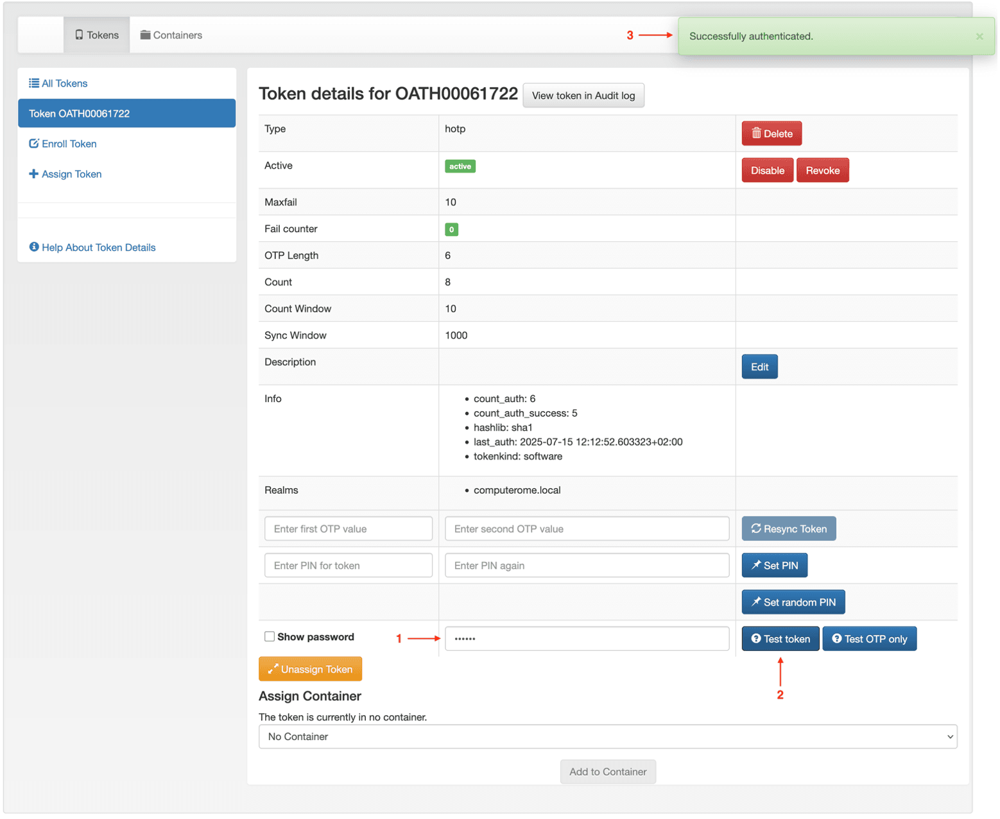{ loading=lazy }

=== "TOTP"

    **Time-based one-time password.** The app shows a 6-digit code that changes
    every 30 seconds.

    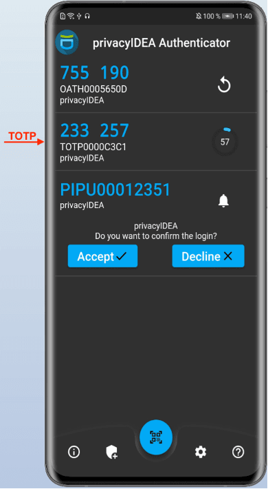{ loading=lazy }

    Follow the **HOTP** steps, but select **TOTP** as the token type in step 1.
    QR code scanning, confirmation and testing are identical.

=== "PUSH"

    **Push notification.** When you log in, the app asks you to **Accept** or
    **Decline** the request.

    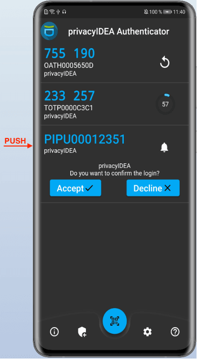{ loading=lazy }

    Follow the **HOTP** steps, but select **PUSH** as the token type in step 1.
    Token testing does not apply to PUSH tokens.

    !!! warning "No notification arrives on your phone"

        privacyIDEA does not push a notification to your phone at login. After
        entering your username and password for any Computerome service, open
        the privacyIDEA app yourself to approve or deny the request.

        If the app was already open, pull down on the token list to refresh it
        so the request appears.

=== "SMS"

    **SMS one-time password.** A code is sent to your mobile phone by SMS when
    you log in.

    1. Select **SMS** as the token type.

        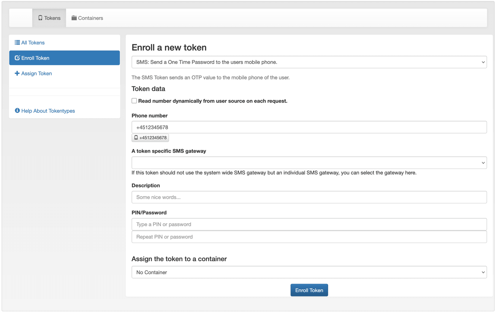{ loading=lazy }

    2. Check that the phone number shown is correct.
    3. Optionally, enter a description in the **Description** field.
    4. Leave all other fields unchanged.
    5. Click **Enroll Token**.
    6. Click **Enroll a new token**.

        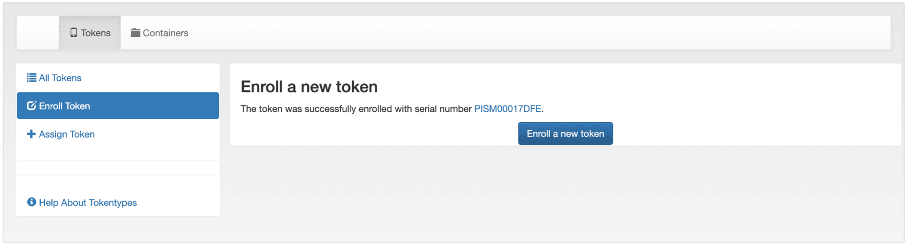{ loading=lazy }

    7. Click **All Tokens** in the left sidebar to see your token in the list.

        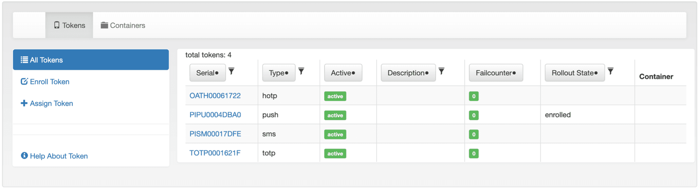{ loading=lazy }
